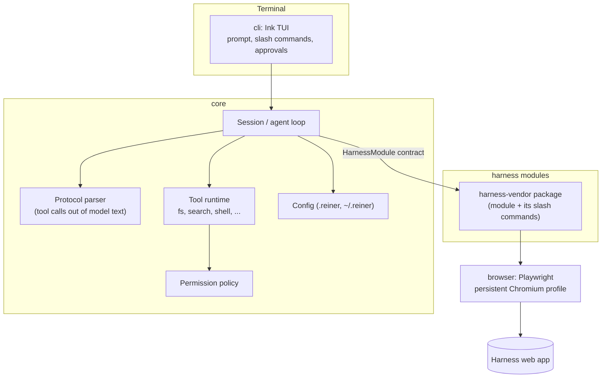
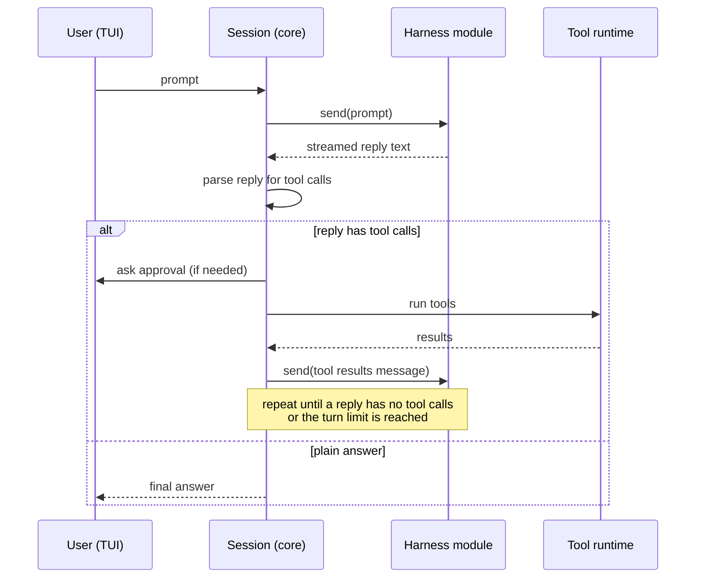
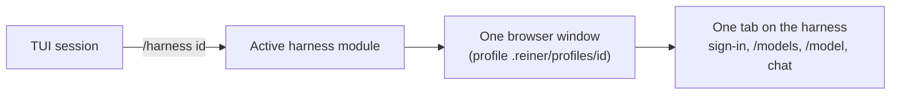

# Architecture overview

Status: **Proposed** (2026-11-07)

## The problem

Some strong models are only reachable through a browser harness that limits them: no file system,
no shell, a small set of built-in tools, a chat UI built for office work. The model itself can reason and
write code well; the harness is the cage. The first harness is Microsoft 365 Copilot
([its docs](../../packages/harness-ms/docs/README.md)).

## The idea

Reiner sits between the user's terminal and the browser harness:

- It **drives the harness** in a background Chromium browser, like a user would.
- It **teaches the model a text protocol** for tool calls, using the harness's own user-level custom
  instructions (personalisation settings), so the instructions persist across chats without being
  pasted into every prompt.
- It **runs the tools locally** (read files, search, edit, run commands), then feeds results back into
  the chat as the next message.
- It **wraps all of this in a familiar CLI**: prompt area, streaming output, slash commands, approvals.

Reiner only ever **controls the harness through its web page**, as a person would. It never calls the
vendor's APIs directly or reads its network traffic: we puppet harnesses, we do not reverse-engineer them
(see the motto in [`AGENTS.md`](../../../AGENTS.md#motto-we-puppet-harnesses)).

The harness's own built-in tools (for example web search, reading the user's cloud files, image
generation) stay available. Reiner adds a layer on top, it does not replace them.

## Layers



| Layer | Package | Knows about |
| --- | --- | --- |
| UI | `cli` | Core events only. Never touches the browser. |
| Core | `core` | The module and command contracts, the tool protocol, config, and the rules every file exchange obeys (share rules, applying changes). No harness specifics, and no way of exchanging files of its own. |
| Exchange | `exchange-packs` | One way a harness can exchange files: packs up, a diff or patch back. Used by harnesses that take uploads ([file-exchange.md](file-exchange.md)). |
| Modules | `harness-<vendor>`, e.g. `harness-ms` (`m365-copilot`) | One harness each: URLs, selectors, how to send and read, the harness's slash commands, and its own docs in `docs/`. |
| Browser | `browser` | Launching Chromium with a profile, shared page helpers. |

The diagram is the target. Today the chat and tool loop runs in the CLI (`tui/chat-loop.ts`), the four
tools are answered by the harness's exchange (`exchange-packs/src/exchange/tools.ts`), and there is no permission policy yet; moving the loop
and a tool registry into core is in the [plan](../plan.md). Slash commands that depend on the harness come
from the module (`HarnessModule.commands`); the CLI adds only global ones ([modules.md](modules.md#harness-commands)).

## The agent loop



Points to note:

- **One turn can be many harness messages.** Each tool round trip is a new chat message in the harness.
  Harnesses have per-chat message limits and context limits, so the session tracks both and can roll
  over into a new chat with a summary (`/compact`).
- **Streaming.** The module emits partial text as it appears, so the TUI streams like a native agent.
  Tool-call parsing only runs on the completed reply.
- **Large payloads.** Tool results can exceed the harness's prompt size limit. The base module truncates
  and paginates. A harness that takes uploads can instead send content as a file (see
  [file-exchange.md](file-exchange.md)).

## Harnesses and the live browser

Why: opening a fresh browser for every command was slow (Edge takes seconds to start and up to a minute
to close) and lost page state such as the chosen model, and users want to watch what Reiner does.

- **Picking a harness.** A project lists its harnesses in `.reiner/config.jsonc` (`harnesses`,
  `defaultHarness`). On first run the TUI asks which harness to use, unless only one is installed or a
  default is set in `~/.reiner/config.jsonc`. `reiner init --harness <id>` does the same without the TUI.
- **One active harness at a time.** `/harness <id>` switches: it closes the current harness's browser,
  makes the new one the project default and opens it. Each harness keeps its own browser profile, sign-in,
  model list and saved model under `.reiner/profiles/<id>/` and `.reiner/modules/<id>/`.
- **One live window and tab.** When a harness becomes active its browser opens on the harness and stays
  open for the whole TUI session. Every command (sign-in, `/models`, `/model`, and chat later) works in
  that same window and tab, so the user can watch it. If the user closes the window, the next command
  opens it again. Quitting the TUI closes it.
- **Page loads reset harness state.** A harness may forget the chosen model on every load (Copilot
  goes back to "Auto"). The module notices page loads and re-applies the project's saved model before the
  next action.
- **One-shot commands** (`reiner <command>`, e.g. `reiner models` or `reiner model …`, and `reiner -p`)
  open the window, do their job and close it.
- **Side pages in a short-lived tab** (since 2026-11-10). A page the module needs besides the chat, such
  as OneDrive, opens in a tab of its own in the same window and closes when done. The chat tab never
  navigates away, so its chat, model and scroll position stay put. Several long-lived tabs or windows
  (subagents) are a [future possibility](#future-subagents).
- **Costs.** Sign-in cookies are written by the browser periodically and on shutdown; quitting waits up to
  10 seconds for a clean close, so a sign-in in the last seconds of a session can in rare cases be lost.
  `/browser show|hide` restarts the browser, because a window cannot switch between visible and headless.
  Switching harnesses closes the previous harness's window.



## Future: subagents

Not planned for a milestone yet. Today everything happens in one window, on one chat tab (plus
short-lived tabs for side pages such as OneDrive). Later, Reiner could run
**subagents**: extra workers that each get their own tab (or their own window or browser context) on a
harness, so several conversations run in parallel.

- **Same harness, parallel chats.** The main agent hands a sub-task to a subagent, which opens a second
  tab on the same harness, works through it with its own chat, and returns a summary as a tool result.
- **Other harness as a tool.** A subagent runs on a different harness (for example Gemini while the main
  agent is on Copilot), so one model can ask another for a second opinion.
- **`@harness` mentions.** The user sends one prompt to another configured harness without switching.
- **What it needs.** A tab pool per module (`HarnessModule` gains something like `openWorker()` returning
  a tab-scoped handle), limits on how many tabs run at once, and care with harness rate limits. If two
  harnesses run at once, either two browsers (one profile each) or one shared profile with a tab per
  harness; to decide then.
- Reiner Agent (the Docker runner) would use the same mechanism to run several tasks at once.

## Instruction injection

Built as plain-text sections ([packs.md](../../packages/exchange-packs/docs/packs.md#instructions-and-sections)).
The pack exchange builds the sections (`files`, `tools`, `index`, `transfer`); `/instructions sync` writes
them into the harness's custom instructions after a backup and a y/N, and reads them back. Only Reiner's
own sections change; the user's own text is kept. A section is one of Reiner's headings up to the first
line of three dashes:

```
## Project tools
...protocol...
---
```

Until the sections are synced in their current form, they travel in the prompt, once per chat and again
after the mode or index setting changes. Prompts that need them carry a short facts line either way.

## Key risks

- **UI drift.** Harness web apps change often. Mitigation: selectors in one file per module, a
  `reiner doctor` self-test, and `--show-browser` / `--keep-browser` to watch what the module does.
- **Model compliance.** The model may ignore or mangle the protocol. Mitigation: tolerant parser,
  a short corrective reply on malformed calls, protocol kept small.
- **Policy.** Automating a corporate service may conflict with an organisation's acceptable-use policy.
  Users are responsible for using it within their own organisation's rules; the docs should say so plainly.
- **Security.** The model's output drives local side effects. Every tool call is untrusted input
  and goes through the permission policy.
